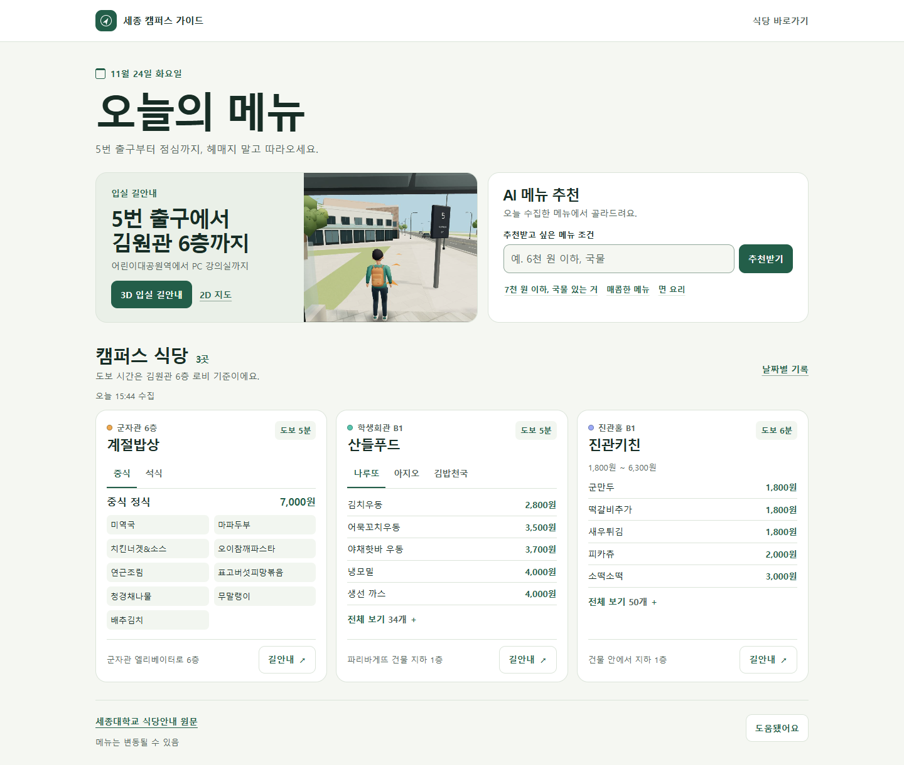
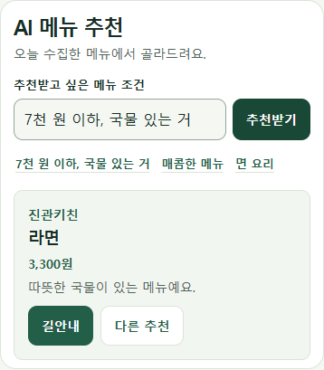
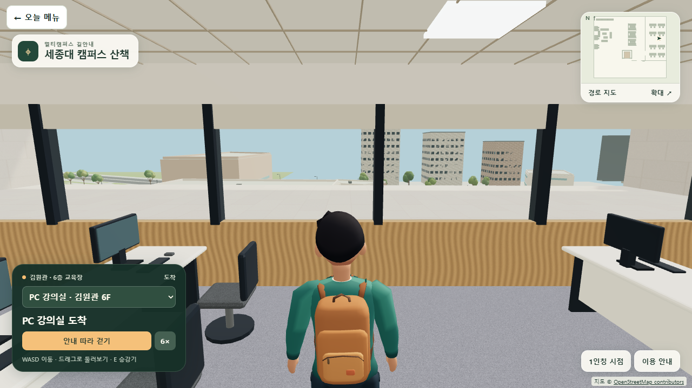

# 세종 캠퍼스 가이드 테스트 보고서

2026년 11월 25일 · 한국시간 · 검증 대상 `97d207c`의 애플리케이션과 이 보고서에 포함된 테스트

## 결과 요약

로컬 테스트 **44건 통과**. pytest 7건, Vitest 18건, Playwright 19건을 실행했다. 식단 비교, 추천, 입실·식당 길안내와 복구 흐름의 화면 **25장**을 아래에 첨부했다.

| 추가 검증 | 결과 |
| --- | --- |
| 첫 화면 성능 | 모의 모바일 4G에서 LCP **1.024초**. 테스트 기준 2.5초를 충족했다. 지연 150ms, 다운로드 1.6Mbps, 업로드 750kbps, CPU 4배 감속을 적용한 한 번의 측정이다. |
| 로컬 추천 API | 빈 조건에 400, `GET /api/chat`에 405가 반환됐다. 같은 클라이언트의 동시 요청 21건 중 20건이 일일 한도 검사를 통과했고, 1건은 `429 rate_limit`과 `Retry-After`를 받았다. |
| 정적 빌드와 타입 | Astro 빌드와 Worker·사이트 TypeScript 검사를 통과했다. 브라우저용 HTML·JS에서 Claude 키 변수명과 Claude API 주소가 검색되지 않았다. 두 3D 모델은 빌드 입력과 산출물의 SHA-256이 일치했다. |

## 검증 환경

- Windows, Node.js 22.20.0, Python 3.13.9, Chrome 158, Astro 6.4.8, Wrangler 4.167.0, Playwright 1.65.1
- 로컬 Worker에서 Astro 정적 페이지와 `/api/chat`을 제공했다. 모바일 화면은 `390 × 844`, 데스크톱 홈은 `1440 × 1000`에서 캡처했다. 3D 보행 검증에는 Chrome의 하드웨어 WebGL(D3D11)을 사용했다.
- 정상 식단 화면의 브라우저 시각은 저장된 식단 기준일인 `2026-11-24 11:55 KST`로 고정했다. 데이터에는 같은 날의 중식·석식 두 건, 전체 일일 식단 12건, 상시 메뉴 144건이 있다. 품질 검증에 사용한 입력 원본과 정규화 결과는 저장소에서 확인할 수 있다. [학교 응답 스냅숏](data/raw/2026-11-24.json) · [식단 스냅숏](data/menu/2026-11-24.json)

## 화면과 사용자 흐름

### 식단 비교와 기록 열람

| 사용자 흐름 | 확인 내용 | 스크린샷 |
| --- | --- | --- |
| 모바일 홈 → 식당 바로가기 | 식당 3곳을 한 열로 비교한다. 가로 넘침과 홈에서의 3D 모델 요청을 검사했다. | [밝은 화면](docs/test-report/screenshots/home-mobile.png) · [어두운 화면](docs/test-report/screenshots/home-mobile-dark.png) |
| 데스크톱 홈 | 식당 3곳이 한 행에 배치된다. | [데스크톱 홈](docs/test-report/screenshots/home-desktop.png) |
| 식사 시간·코너 변경 → 전체 보기 → 접기 | 계절밥상 중식·석식과 7,000원 가격을 확인했다. 산들푸드 코너를 키보드로 바꾸고 상시 메뉴가 5건에서 전체로 펼쳐졌다가 다시 5건으로 접히는지 검증했다. | [산들푸드 메뉴 펼침](docs/test-report/screenshots/menu-expanded.png) |
| 날짜별 기록 → 오늘 메뉴 | 11월 24일 기록과 학교 원문 링크를 확인하고 홈으로 돌아왔다. | [날짜별 식단 기록](docs/test-report/screenshots/archive.png) |
| 기준일 경과 / 주말 휴무 | 마지막 수집분의 날짜와 원문 링크를 표시한다. 주말에는 계절밥상 휴무를 표시하고 일일 식단 탭을 숨긴다. 브라우저 날짜를 바꿔 확인했다. | [마지막 수집분](docs/test-report/screenshots/stale-menu.png) · [주말 화면](docs/test-report/screenshots/weekend-closed.png) |
| 식단 확인 → 도움됐어요 | `aria-pressed`가 선택 상태로 바뀌고 두 번 눌러도 브라우저의 테스트용 이벤트 수집기에 `helpful_click`이 한 번만 기록됐다. | [피드백 선택](docs/test-report/screenshots/feedback.png) |



### 추천에서 식당까지

| 사용자 흐름 | 확인 내용 | 스크린샷 |
| --- | --- | --- |
| 예시 조건 → 추천받기 | 예시 문장이 입력란에 채워진다. 응답을 기다리는 동안 진행 문구가 보이고 입력·제출이 잠긴다. | [추천 대기](docs/test-report/screenshots/recommendation-loading.png) |
| 첫 추천 → 다른 추천 | 진관키친 라면 3,300원과 추천 이유를 표시한다. 재요청에 첫 결과 ID가 포함되며 순두부찌개 5,000원과 길안내 버튼이 표시된다. 추천 API 성공 응답은 테스트에서 대체했다. | [첫 추천](docs/test-report/screenshots/recommendation.png) · [다른 추천](docs/test-report/screenshots/recommendation-alternate.png) |
| 추천 결과 → 길안내 → 오늘 메뉴 | 진관키친을 목적지로 삼아 김원관 6층 로비에서 3D 보행을 시작하고 사용자가 홈으로 복귀할 수 있다. | [추천에서 시작한 3D 길안내](docs/test-report/screenshots/map-recommendation.png) |
| 연결 끊김 / 8초 응답 지연 | 연결을 끊었을 때 저장된 메뉴 중 6,000원 이하 결과와 폴백 문구가 표시됐다. 응답을 멈춘 상태에서 브라우저 타이머를 8초 진행시켜 입력과 제출이 복구되는 것도 확인했다. | [가격 기준 추천](docs/test-report/screenshots/recommendation-fallback.png) |
| 메뉴 없음 / 오래된 식단 / 휴무 / 횟수 초과 | 테스트 응답 코드에 따라 각각 사유를 표시하고 길안내 버튼을 숨긴다. 입력란은 다시 사용할 수 있다. | [메뉴 없음](docs/test-report/screenshots/recommendation-no_match.png) · [오래된 식단](docs/test-report/screenshots/recommendation-stale.png) · [주말 휴무](docs/test-report/screenshots/weekend-closed.png) · [횟수 초과](docs/test-report/screenshots/recommendation-rate_limit.png) |



### 입실과 3D·2D 길안내

| 사용자 흐름 | 확인 내용 | 스크린샷 |
| --- | --- | --- |
| 홈 → 3D 입실 길안내 → PC 강의실 → 오늘 메뉴 | 5번 출구의 자동 보행, 캐릭터 좌표 변화, 일시 정지·재개, 3배속·6배속, 6층 이동과 PC 강의실 도착, 홈 복귀를 확인한다. | [입실 보행 시작](docs/test-report/screenshots/map-auto.png) · [PC 강의실 도착](docs/test-report/screenshots/map-classroom-arrival.png) |
| 식당 카드 → 3D 자동 보행 → 건물 입구 | 김원관 6층 로비에서 식당별 목적지를 적용하고 건물 입구에 도착했을 때 마지막 층 이동 안내를 확인한다. | [계절밥상](docs/test-report/screenshots/map-arrival-gunja.png) · [산들푸드](docs/test-report/screenshots/map-arrival-student.png) · [진관키친](docs/test-report/screenshots/map-arrival-jingwan.png) |
| 3D 수동 모드 → 이용 안내 → 터치 이동 | 출발층과 목적지를 설정한다. 도움말에서 5번 출구로 이동한 뒤 1인칭 전환과 화면 방향 버튼에 따른 좌표 변화를 확인한다. | [3D 이용 안내](docs/test-report/screenshots/map-help.png) · [수동 보행](docs/test-report/screenshots/map-mobile-manual.png) |
| 홈 → 2D 입실 지도 | 3D 모델 요청 없이 경로 개요와 김원관 승강기 6층 이동 단계를 표시한다. | [2D 입실 지도](docs/test-report/screenshots/map-2d.png) |
| 산들푸드 3D 모델 실패 → 2D 안내 → 3D 재시도 | 모델 요청을 차단하면 식당의 2D 경로와 지하 1층 안내를 표시한다. 차단을 해제하고 재시도하면 같은 출발지와 목적지가 3D 수동 화면에 적용된다. | [실패 시 2D 지도](docs/test-report/screenshots/map-2d-fallback.png) |



## 기능별 단위 테스트

pytest 7건, Vitest 18건이 통과했다. 아래의 건수는 각 테스트를 한 번씩 집계한다.

| 요구사항 | 기능과 검증 조건 | 통과 |
| --- | --- | ---: |
| F1 · 식단 정규화 | 학교 응답 5종의 저장본에서 수집일·중식/석식·산들푸드 3개 코너·양수 가격을 확인했다. 잘못된 요일, 존재하지 않는 날짜, 문자열 가격, 빈 메뉴명은 각각 거부됐다. | 5/5 |
| F1 · 식단 갱신 판정 | 이전 주 데이터가 남은 응답을 거부하고, 일일 식단이 빈 정상 응답은 미운영으로 처리했다. | 1/1 |
| F1 · 메뉴 태깅 | 미태깅 메뉴 한 건만 요청한다. 동시 실행과 후속 실행은 캐시를 재사용하고, 허용된 태그만 보관한다. 태깅 결과가 누락되면 이전에 공개한 태그를 유지한다. | 2/2 |
| F2 · 게시 파일 생성·보존 | 보관 원본으로 날짜별 글을 생성했다. 다음 실행에 검증 실패를 주입한 뒤 기존 원본, 식단 JSON과 게시 글의 바이트가 모두 같은지 비교했다. | 1/1 |
| F4 · 한국어 예산 해석 | `7천 원 이하`, `7,000원 미만`, `1만 2천원까지`, `６０００원 이내`, `5천원대`, 상한 없는 문장 두 가지를 각각 확인했다. | 7/7 |
| F4 · 날짜와 영업일 | 14:59:59 UTC → 15:00:00 UTC에 서울 날짜가 전환된다. 지난 수집분이나 토요일에는 추천 후보를 생성하지 않는다. | 2/2 |
| F4 · 추천 후보 선별·결과 검증 | 예산, 식당 다양성, 40개 제한과 후보 메뉴 구성을 확인했다. 모델의 후보 외 ID를 거부하고 원본 메뉴·가격·길안내 링크를 사용한다. | 2/2 |
| F4 · Claude 요청·추천 이유 | 테스트 응답에서 실제 후보와 일치하는 국물 태그가 추천 이유에 쓰였다. 요청 URL, 인증·워크스페이스 헤더, JSON 스키마와 후보 개수도 검사했다. | 1/1 |
| F4 · 추천 폴백 | 호출 시간 초과 시 이전 선택을 제외한다. 후보가 없으면 Claude 호출 없이 404를 반환하며, 유효하지 않은 모델 결과, 키 누락과 잘린 답변은 가격 기준 결과로 처리한다. | 4/4 |
| **단위 테스트 합계** | [수집·게시 테스트](tests/python/test_pipeline.py) · [추천 테스트](tests/unit/recommend.test.ts) · [태그 테스트](tests/unit/menu-tags.test.ts) | **25/25** |

F3 식당 카드, F5 길안내와 F6 피드백은 화면 상호작용으로 검증했다. [Playwright 시나리오](tests/e2e/campus.spec.ts)

## 발견 사항과 남은 검증

- 2D 폴백은 정상 표시됐으며, 모델 요청을 막은 경우 안내 문구에 기술 오류 문구 `Failed to fetch`도 노출됐다. [실패 시 2D 화면](docs/test-report/screenshots/map-2d-fallback.png)
- [구현 명세](SPEC.md)는 데스크톱에서도 식당 카드 1열을 명시한다. 현재 `1440px` 홈에서는 3열이 표시된다. [화면 증빙](docs/test-report/screenshots/home-desktop.png)
- 소프트웨어 WebGL로 먼저 실행했을 때 추천 후 홈 복귀와 입실 도착 검사가 시간 제한에 걸렸다. 하드웨어 WebGL로 전체를 다시 실행해 19건 통과를 확인했다.
- Claude는 테스트 응답으로 후보 검증과 추천 이유 표시를 확인했다. 실제 모델의 다양한 요청에 대한 추천 품질과 예약 태깅 결과는 확인하지 못했다.
- 자동 게시의 파일 생성과 검증 실패 시 기존 파일 보존은 로컬에서 재현했다. GitHub Actions의 평일 실행, 실패 Issue 생성, Cloudflare 운영 배포, GA4 수신은 이번 결과에 포함되지 않는다.
- 날짜별 글은 저장된 기록 한 건으로 검증했다. 이전·다음 기록 이동, 실제 휴대전화·4G에서의 성능, 실제 캠퍼스 동선과 3D 모델의 일치는 확인하지 못했다.

## 재현 명령

프로젝트 의존성이 설치된 PowerShell에서 실행한다. 아래 환경 변수는 이번에 사용한 Chrome과 하드웨어 WebGL을 선택한다. Playwright는 `test-results/screenshots/`에 캡처를 다시 생성한다.

```powershell
python -m pytest -v --basetemp=".local/pytest-report-$([guid]::NewGuid())"
npm test -- --reporter=verbose
npm run check
$env:TEST_BROWSER_CHANNEL = 'chrome'
$env:TEST_BROWSER_GPU = '1'
npm run test:e2e
```
